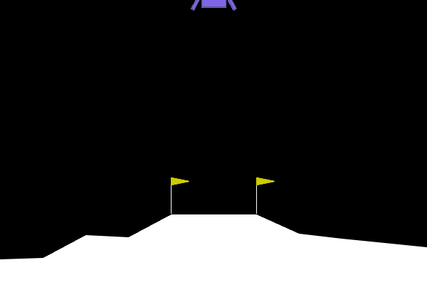
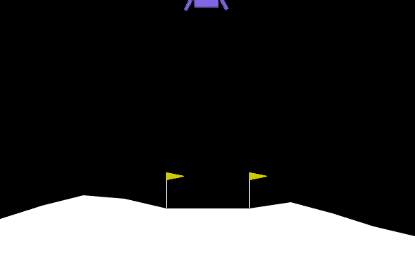
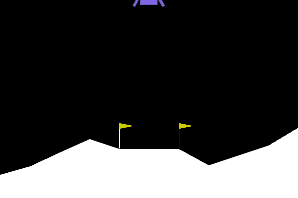
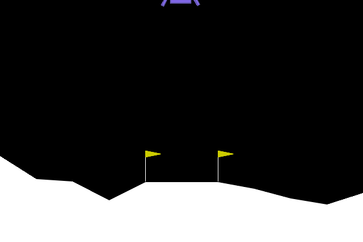
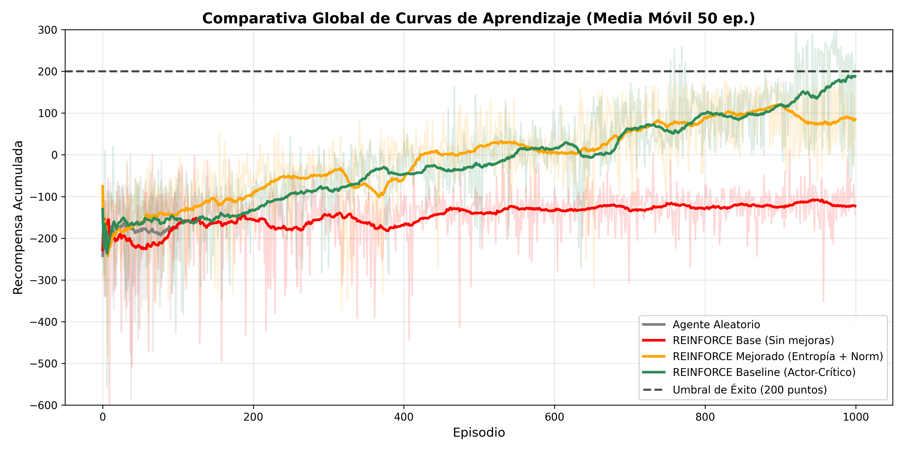
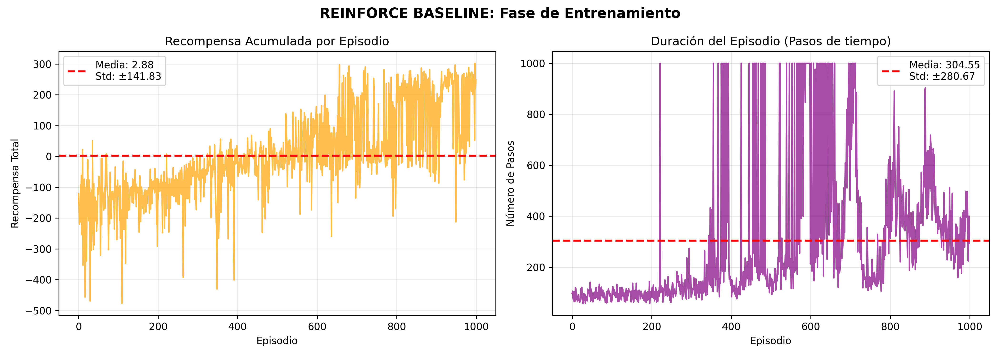
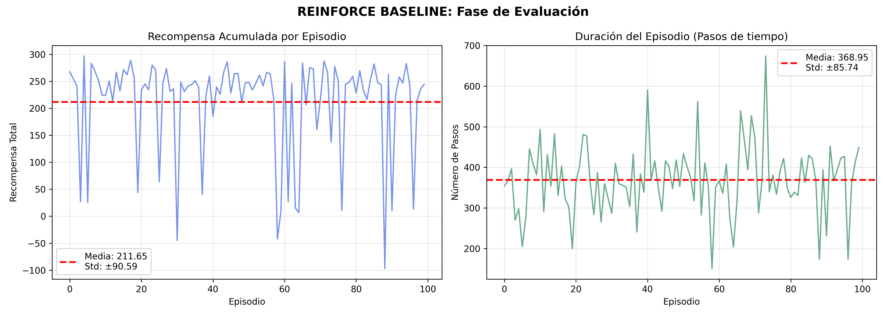

# Policy Gradients on LunarLander: REINFORCE with Baselines

Implementation and comparison of policy-gradient methods on Gymnasium's **LunarLander-v3**, a continuous-state, discrete-action control problem where an agent must land a spacecraft between two flags. The project builds up from a random policy to vanilla REINFORCE, then to variance-reduction techniques, and measures what each one contributes.

| Random policy | REINFORCE (vanilla) | + Normalization & entropy | + Value baseline |
|:---:|:---:|:---:|:---:|
|  |  |  |  |

## Key Findings

- **Vanilla REINFORCE did not learn to fly.** Its evaluation reward (-102.04) beats the random policy (-178.19), but episodes last only ~90 steps: the agent learned to drop and crash, avoiding fuel penalties instead of landing.
- **Return normalization plus an entropy bonus changed the behaviour.** Normalizing returns gives below-average trajectories a negative signal and above-average ones a positive one, and the entropy bonus keeps the policy exploring. The mean evaluation reward rose to **90.31**, but the agent often hovers until the 1,000-step limit rather than landing.
- **A learned value baseline gave the best result.** Subtracting a state-value estimate from the returns reduced gradient variance and reached **188.56** mean evaluation reward, close to the 200-point "solved" threshold.
- **Actor and critic need different learning rates.** A critic that is too slow gives noisy advantages and behaves like vanilla REINFORCE, while one that is too fast destabilizes the actor. Using 1e-3 for the actor and 5e-3 for the critic worked best.

## Environment

LunarLander-v3 (Gymnasium, Box2D): 8-dimensional continuous state, 4 discrete actions (no-op, left engine, main engine, right engine). Landing gives +100, crashing -100, and firing engines costs reward on every step. The task is considered solved at an average of 200 points.

## Methods

| Method | Description |
|---|---|
| **Random policy** | `env.action_space.sample()`, used as a lower bound |
| **REINFORCE (vanilla)** | Policy network trained with Monte Carlo returns |
| **REINFORCE + improvements** | Adds return normalization (zero mean, unit variance per episode) and an entropy bonus (beta = 0.01) |
| **REINFORCE + baseline** | Adds a value network V(s) as a baseline; the policy update uses the advantage A = G_t - V(s_t), and the critic is trained with MSE against the returns |

### Hyperparameters

| Hyperparameter | Value |
|---|---|
| Optimizer | Adam (SGD collapsed to -548.72 in early tests) |
| Learning rate (actor) | 0.001 |
| Learning rate (critic) | 0.005 |
| Discount factor (gamma) | 0.99 (gamma = 0.5 made the agent short-sighted and it stopped using the engines) |
| Hidden units | 128 (64 and 256 gave equivalent results) |
| Training episodes | 1,000 |

Hyperparameters were explored with seven variants over short 300-episode runs. A learning rate of 0.01 looked best early on but diverged over longer training, and 0.0001 learned too slowly.

## Results

Evaluation over 100 episodes after training:

| Method | Mean reward | Std | Mean episode length | Solved (>= 200) |
|---|---|---|---|---|
| Random policy | -178.19 | 110.27 | 89.2 | No |
| REINFORCE (vanilla) | -102.04 | 36.74 | 90.6 | No |
| REINFORCE + normalization + entropy | 90.31 | 64.36 | 659.0 | No |
| **REINFORCE + value baseline** | **188.56** | 95.13 | 432.9 | No |

<p align="center">
  
</p>

The comparison of training curves (50-episode moving average) shows vanilla REINFORCE plateauing around -120, the improved version leaving negative rewards after ~400 episodes, and the baseline version climbing steadily towards the 200-point line by the end of training.

<p align="center">
  
  
</p>

The higher standard deviation of the baseline agent compared with vanilla REINFORCE does not mean worse learning. The vanilla agent is consistent only because it fails in the same way every time.

## Repository Structure

```
.
├── README.md
├── Practica3_AV.ipynb     # Implementation and experiments
├── Memoria_P3.pdf         # Written report (Spanish)
└── images/                # Learning curves, frames and GIFs
```

## Getting Started

```bash
git clone https://github.com/izancuesta14/lunarlander-policy-gradients.git
cd lunarlander-policy-gradients
pip install torch "gymnasium[box2d]" numpy matplotlib imageio jupyter
```

Open `Practica3_AV.ipynb` and run the cells in order. Training each agent for 1,000 episodes runs on a CPU.

**Stack:** Python, PyTorch, Gymnasium, NumPy, Matplotlib.

## Limitations and Future Work

- Each method was trained **once**, with no multiple seeds or confidence intervals. Policy-gradient results are noisy, so differences between methods should be confirmed over several runs.
- Normalization and entropy bonus were evaluated together, so their individual contributions are not separated. An ablation would clarify this.
- The baseline agent approaches but does not consistently reach 200 points. Training for longer would likely help, as its curve was still rising at episode 1,000.
- REINFORCE with a learned baseline still uses full Monte Carlo returns. Moving to bootstrapped methods (A2C, PPO with GAE) is the natural next step for lower variance and better sample efficiency.

## Author

**Izan Cuesta Corbí**
University of Alicante, Escuela Politécnica Superior
Contact: icc87@alu.ua.es

*Originally developed as coursework for the Advanced Learning course (2025/2026). The written report is in Spanish.*
